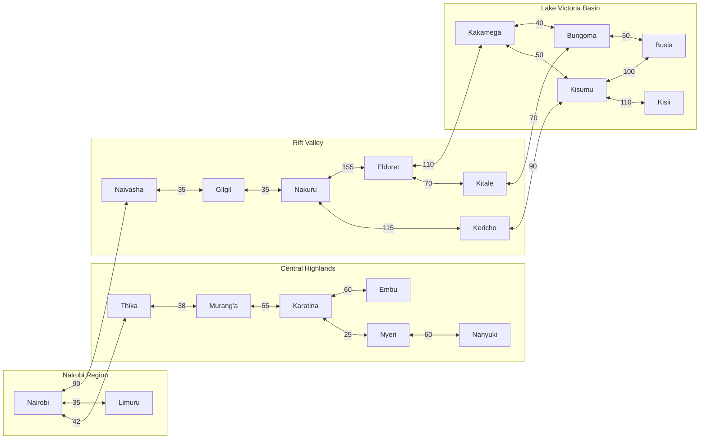
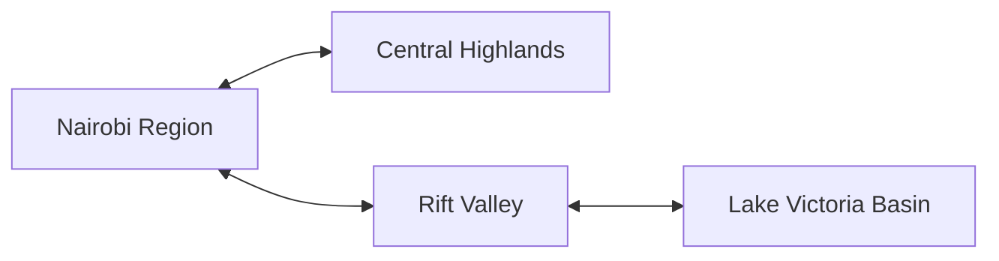
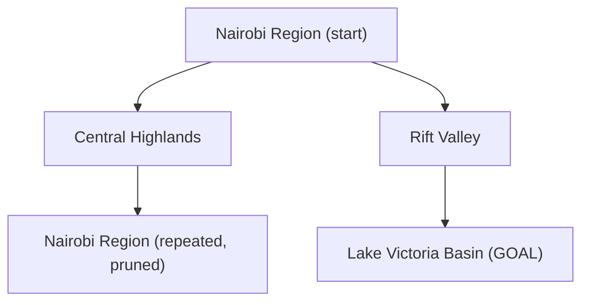
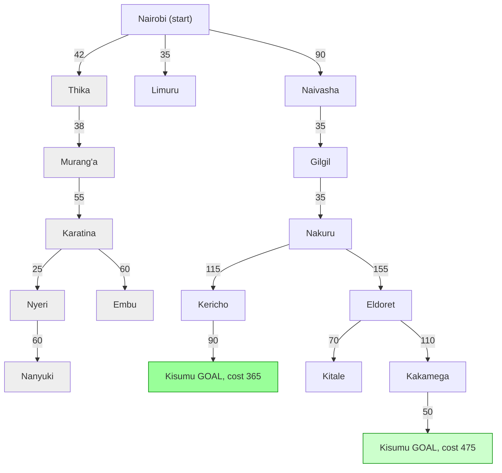
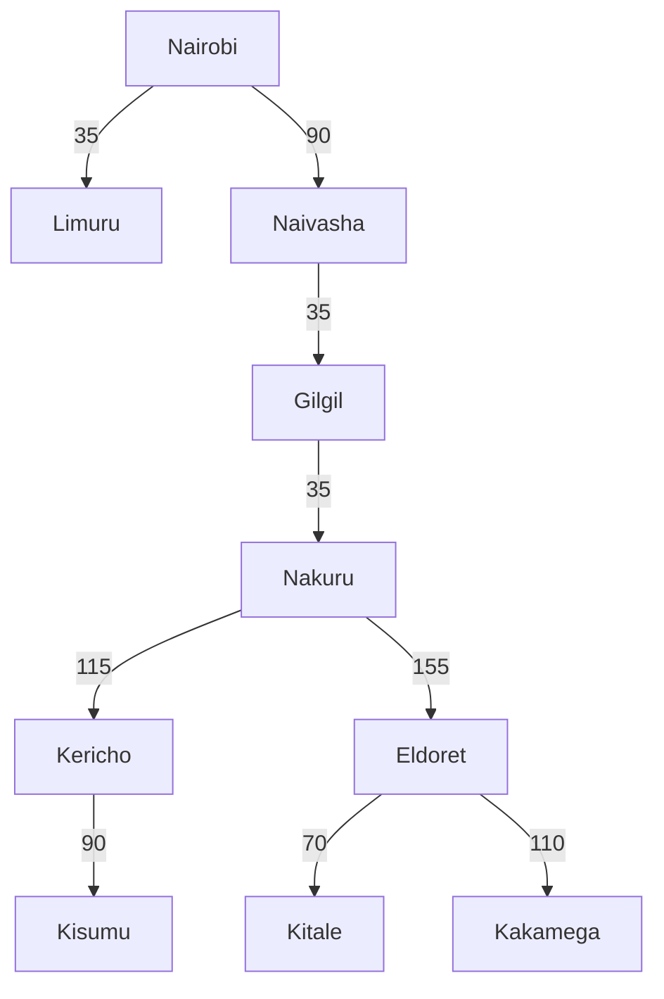

167249 -Obosi Eliud Odhiambo 
189806 -Meli Ronel Chepchirchir 
189982 -Jason Mageto

## Question 1
 - a) Performance Measure -Customer safety, fuel efficiency trip, the least time taken for a trip. 
 - b) Environment -Road, the traffic rules or laws, pedestrians, customers to receive packages, highways, junctions, weather conditions. 
 - c) Actuators -Steering wheel, accelerator, the brake, horn, gear selection, indicators, whipper, headlights 
 - d) Sensors -GPS, solar radar, cameras, rain sensors

 # Part B
 - Not Completely Observable: Not everything can be observed at once. There is a limited visibility of the environment because of the limitations in the sensors, and the objects may be occluded (a pedestrian that suddenly appears from behind the stopped van).

- Stochastic: The environment itself is stochastic in nature. Although the physics of the robot itself is deterministic, the behavior of pedestrians, animals, and weather conditions is not known in advance.

- Sequential: Decisions made now will have effects on the future. A fast decision (such as moving the car away from a puddle) will influence where the robot is now, how safe it is, and whether it will make the entire path to its destination safely.

- Dynamic: The environment evolves during the decision process. People keep walking and vehicles keep moving even if the robot stops for a while to consider its actions.

Continuous: Time, speed, angles of turning, and positions are considered continuous variables.

 ## Question 2
 - Develop a suitable directed graph and search tree based on the map presented in class of Kenya’s Highway Network featuring cities and towns in the Nairobi, Central Highlands, Rift Valley and Lake Victoria Basin regions. For reference, you can use this Google Maps view to generate the graph and tree. The tree should apply the concept of abstraction as discussed in class.

 # Kenya Highway Network: Directed Graph and Search Tree

## 1. Problem Formulation

| Element | Definition |
|---|---|
| **State** | The town or city the traveller is currently in |
| **Initial state** | Nairobi |
| **Goal state** | Kisumu |
| **Actions** | Drive along a highway to an adjacent town |
| **Transition model** | `Result(Town, Drive to Neighbour) = Neighbour` |
| **Path cost** | Distance in km (approximate) |

**Why directed?** Each highway is modelled as two directed edges (A → B and B → A), so one-way restrictions or closures can be added later by deleting a single edge.

---

## 2. Regions and Nodes

| Region | Towns / Cities |
|---|---|
| Nairobi | Nairobi, Limuru |
| Central Highlands | Thika, Murang'a, Karatina, Nyeri, Nanyuki, Embu |
| Rift Valley | Naivasha, Gilgil, Nakuru, Kericho, Eldoret, Kitale |
| Lake Victoria Basin | Kisumu, Kakamega, Bungoma, Busia, Kisii |

---

## 3. Directed Graph (Mermaid)

> In VS Code, install the *Markdown Preview Mermaid Support* extension, then press `Ctrl+Shift+V`.



> `<-->` is shorthand for two directed edges, one in each direction.

---

## 4. Abstraction

Abstraction is applied in two levels:

- **Level 1 (abstract):** each region becomes a single super-node, and a super-edge exists if any highway connects two regions.
- **Level 2 (concrete):** each super-node is refined into its towns, and the search tree is expanded using the actual towns and roads.

The abstract plan **Nairobi → Rift Valley → Lake Victoria Basin** is found first. Only the towns inside those regions are then searched. This prunes the Central Highlands, which is a dead end for reaching Kisumu.

### 4.1 Abstract graph (Level 1)



### 4.2 Abstract search tree (Level 1), Nairobi to Lake Victoria Basin



### 4.3 Refined search tree (Level 2), Nairobi to Kisumu

Repeated states along a path are pruned, and edge labels are costs in km.



The grey nodes

## 5. Python Implementation

```python
# paste the full contents of kenya_graph.py here
```

## 6. Program Output

```text
# paste the full contents of output.txt here
```

## 7. Search Tree Generated by the Code

This is the tree the program actually expanded after applying the abstract plan (Central Highlands pruned):




**Explanation:** Uniform-cost search reached Kisumu via Kericho at cost 365 km, so the costlier branch through Kakamega was never expanded. Thika and the other Central Highlands towns do not appear because the Level 1 plan (Nairobi → Rift Valley → Lake Victoria Basin) excluded them.

## Question 3
- using distance between towns as the path cost function, determine the optimal path
the trailer can take from Nairobi to Kisumu. Calculate the distance between towns
using this Google Maps search feature.

## Worked Solution: Optimal Path Nairobi → Kisumu

### Step 1 — Setup

- **Start node:** Nairobi (g = 0)
- **Goal node:** Kisumu
- **Cost function:** g(n) = cumulative distance in km
- **Algorithm:** Uniform-Cost Search — always expand the frontier node with the
  lowest cumulative g(n). Since all edge costs are positive, the first time the
  goal is popped from the frontier, that path is guaranteed optimal.

### Step 2 — Relevant edges (from the road network)

| Edge | Distance (km) |
|---|---|
| Nairobi – Thika | 42 |
| Nairobi – Limuru | 35 |
| Nairobi – Naivasha | 90 |
| Thika – Murang'a | 38 |
| Murang'a – Karatina | 55 |
| Karatina – Nyeri | 25 |
| Karatina – Embu | 60 |
| Nyeri – Nanyuki | 60 |
| Naivasha – Gilgil | 35 |
| Gilgil – Nakuru | 35 |
| Nakuru – Kericho | 115 |
| Nakuru – Eldoret | 155 |
| Eldoret – Kitale | 70 |
| Eldoret – Kakamega | 110 |
| Kericho – Kisumu | 90 |
| Kakamega – Kisumu | 50 |

### Step 3 — Frontier expansion trace (UCS)

| Step | Node popped | g(n) | New frontier nodes added (g) |
|---|---|---|---|
| 1 | Nairobi | 0 | Limuru (35), Thika (42), Naivasha (90) |
| 2 | Limuru | 35 | — (dead end, Nairobi already visited) |
| 3 | Thika | 42 | Murang'a (42+38=80) |
| 4 | Naivasha | 90 | Gilgil (90+35=125) |
| 5 | Murang'a | 80 | Karatina (80+55=135) |
| 6 | Gilgil | 125 | Nakuru (125+35=160) |
| 7 | Karatina | 135 | Nyeri (135+25=160), Embu (135+60=195) |
| 8 | Nakuru | 160 | Kericho (160+115=275), Eldoret (160+155=315) |
| 9 | Nyeri | 160 | Nanyuki (160+60=220) |
| 10 | Embu | 195 | — (dead end) |
| 11 | Nanyuki | 220 | — (dead end) |
| 12 | Kericho | 275 | **Kisumu (275+90 = 365)** |
| 13 | Eldoret | 315 | Kitale (385), Kakamega (425) |
| 14 | **Kisumu** | **365** | **GOAL — stop here** |

At step 14, Kisumu is popped with g = 365. Every remaining frontier node
(Kitale = 385, Kakamega = 425) already has a higher cost, and since all
edge weights are non-negative, no cheaper path to Kisumu can still be
discovered. **365 km is therefore optimal.**

(For completeness: the alternate route via Eldoret → Kakamega → Kisumu
would cost at least 425 + 50 = 475 km — confirming it is worse.)

### Step 4 — Path reconstruction

Tracing parent pointers backward from Kisumu:


Reversing gives the forward route:

**Nairobi → Naivasha → Gilgil → Nakuru → Kericho → Kisumu**

### Step 5 — Cost breakdown

| Segment | Distance (km) |
|---|---|
| Nairobi → Naivasha | 90 |
| Naivasha → Gilgil | 35 |
| Gilgil → Nakuru | 35 |
| Nakuru → Kericho | 115 |
| Kericho → Kisumu | 90 |
| **Total** | **365 km** |

### Conclusion


> **Nairobi → Naivasha → Gilgil → Nakuru → Kericho → Kisumu, total cost = 365 km**

This matches the path produced by the `concrete_search()` UCS function and
the highlighted red route in `search_tree.png`.